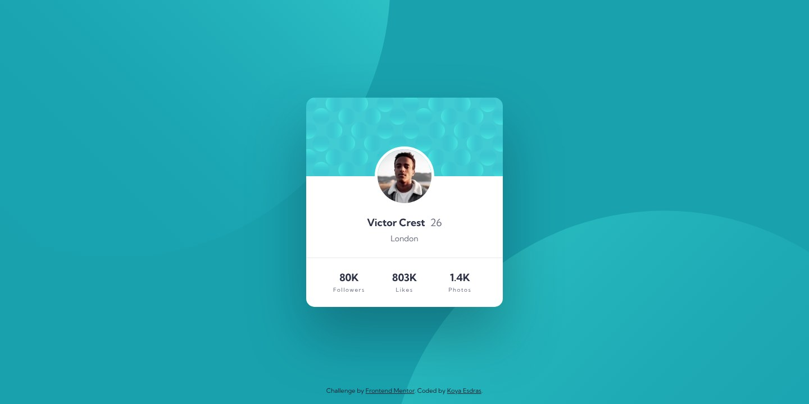

# Frontend Mentor - Profile card component solution

This is a solution to the [Profile card component challenge on Frontend Mentor](https://www.frontendmentor.io/challenges/profile-card-component-cfArpWshJ). Frontend Mentor challenges help you improve your coding skills by building realistic projects.

## Table of contents

- [Overview](#overview)
  - [Screenshot](#screenshot)
  - [Links](#links)
- [My process](#my-process)
  - [Built with](#built-with)
  - [Workflow](#workflow)
  - [What I learned](#what-i-learned)
  - [Continued development](#continued-development)
  - [Useful resources](#useful-resources)
  - [AI Collaboration](#ai-collaboration)
- [Author](#author)

## Overview

### Screenshot



### Links

- Solution URL: [frontendmentor.io/solutions/profile-card-component-7M77igoS7f](https://www.frontendmentor.io/solutions/profile-card-component-7M77igoS7f)
- Live Site URL: [ounokoya.github.io/front-profile-card](https://ounokoya.github.io/front-profile-card/)

## My process

### Built with

- Semantic HTML5: an `article` in `main`, the name as the page's `h1` with the age beside it (not inside the heading), the statistics as a description list (`dl`), the photo as a decorative `img`
- [Tailwind CSS v4](https://tailwindcss.com/) — design tokens in `@theme`, default palette removed, named utilities (`card-pattern`, `separator`, `page-bg`, `link`)
- Kumbh Sans served with the site through [Fontsource](https://fontsource.org/)
- The two background circles placed from the centre of the window with `background-position: calc(50% + …)`, at the offsets measured on the design files (different on mobile and desktop)
- The attribution in a darker navy on the cyan page (5.05:1) instead of the starter's blue (2.32:1)
- [Vite](https://vite.dev/) for the build, deployed on GitHub Pages from the `gh-pages` branch (`npm run deploy`)
- [Playwright](https://playwright.dev/), [axe-core](https://github.com/dequelabs/axe-core), the W3C Nu validator, html-validate and ESLint for tests

### Workflow

This is version 2 of my 2023 solution, rebuilt from the current starter in the same repository. Before any code, the design was analysed and rebuilt:

1. **Visual analysis in Excalidraw** — measurements in px, contrast checks, the HTML tree → [`specs/visuel/`](./specs/visuel/)
2. **Penpot mockup** — library, desktop, mobile and tablet screens, visual thresholds calibrated against the design JPGs → [`specs/visuel/penpot/`](./specs/visuel/penpot/)
3. **Spec, then tests** — 17 Given/When/Then scenarios and the accessible names the tests rely on → [`specs/specifications/`](./specs/specifications/); the tests were written before the code and checked to fail on the starter
4. **Decisions** — tokens, fonts, the photo and the background circles, the centred card → [`specs/adr/`](./specs/adr/)
5. **Code**, then a walk-through in a real browser → [`specs/analyse/`](./specs/analyse/)

### What I learned

**Statistics read in the right order.** A screen reader should say "Followers, 80K", but the design shows the number first. A description list keeps the reading order, and CSS only swaps the display:

```html
<div class="flex flex-col">
  <dt class="order-2">Followers</dt>
  <dd class="order-1">80K</dd>
</div>
```

**`overflow: clip` does not contain margins.** The photo's top margin went through the card, which started 87 px too low; `overflow: hidden` would have stopped it, `clip` does not. Padding on the card fixed it.

**Placing a background image from the centre.** With `background-position: calc(50% + 10px)`, the 50 % applies to the free space, not to the box: to put the corner of a 978 px image at "centre + d", the offset is `d + 489px`.

### Continued development

- **Visual comparison with the design files.** Screenshots differ from the Frontend Mentor JPGs by 0.49 % (desktop) and 2.08 % (mobile) of pixels, for a 5 % threshold.
- **Tablet**: my own proposal, the same card centred, with the circles placed as on desktop.

### Useful resources

- [MDN — `<dl>`](https://developer.mozilla.org/en-US/docs/Web/HTML/Reference/Elements/dl) — name and value pairs.
- [MDN — `background-position`](https://developer.mozilla.org/en-US/docs/Web/CSS/background-position) — how percentages and lengths combine.
- [MDN — `overflow: clip`](https://developer.mozilla.org/en-US/docs/Web/CSS/overflow#clip) — it does not create a new formatting context.

### AI Collaboration

I used **Claude (Claude Code)** as a pair, inside my own spec-driven workflow where I validated each step before the next one:

- **Planning**: Claude listed my old solutions that needed a rebuild and wrote the plan, which I validated.
- **Design analysis and mockup**: Claude measured the JPG designs, drew the annotated Excalidraw analysis and built the Penpot mockup; I reviewed both and decided on the attribution colour, the statistics markup, the decorative photo, the heading and the tablet layout.
- **Spec and tests**: written by Claude before any code, from the validated mockup.
- **Technical decisions**: fonts from Fontsource, as in my earlier solutions without font files in the starter.
- **Code**: written by Claude from the spec — I confirmed this split at the code lock — with the tests run at each step.

What worked well: comparing the page with the design pixel by pixel explained every difference before it was fixed. What needed my decisions: the choices listed above.

## Author

- Frontend Mentor - [@ounokoya](https://www.frontendmentor.io/profile/ounokoya)
- GitHub - [@ounokoya](https://github.com/ounokoya)
